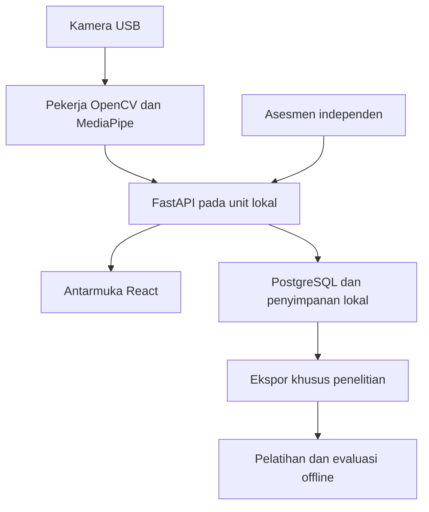

# Blueprint arsitektur AI-FACE

## Sasaran dan batas fase

| Fase | Hasil |
|---|---|
| A · Akuisisi | Webcam lokal, pratinjau, gerakan wajah real-time, sesi 30 detik, validitas dan ekspor |
| B · Riset data | Form label rujukan independen, basis data, pengelolaan versi protokol, audit, dan dataset berizin |
| C · Model | Evaluasi offline XGBoost dan pembanding pada peserta terpisah |
| D · Integrasi penelitian | Registri model dan keluaran per sesi sesuai kebijakan akses setelah kelayakan disetujui tim |

Satu klinik komputer lokal dan satu kamera pada MVP. Python + OpenCV + MediaPipe pada pekerja kamera. FastAPI mengendalikan sesi, React + TypeScript menampilkan antarmuka, PostgreSQL menyimpan metadata. File fitur tersimpan di volume lokal terkontrol. Latih model pada lingkungan penelitian terpisah. Pengembangan boleh di Windows dengan venv, sedangkan target unit tetap mengikuti rancangan Ubuntu 24.04 LTS.



**Satu pemilik kamera.** Hanya pekerja lokal yang membuka perangkat. Pratinjau dan ekstraksi berbagi frame bertimestamp. FastAPI dan browser tidak membuka kamera kedua. Untuk MVP gunakan satu proses layanan dengan satu pekerja kamera, atau jalankan pekerja khusus sebelum mengaktifkan beberapa proses API. Asesmen dicatat melalui jalur terpisah dari prediksi.

| Peran | Aktivitas |
|---|---|
| Operator | Buat sesi, pantau kualitas, hentikan atau ulangi perekaman |
| Penilai | Catat asesmen independen, lihat identitas berkode yang diperlukan |
| Peneliti | Ekspor data dengan otorisasi dan evaluasi offline |
| Admin | Atur perangkat, protokol, persetujuan dan versi model, tinjau audit |

Status sesi `ready → recording → processing → completed`, dengan jalur terminal `cancelled` atau `failed`. Kualitas `pending | pass | insufficient`. Status estimasi `not_available | withheld | available` dipisah dari status sesi dan kualitas. `withheld` berarti model tersedia pada konteks tersebut tetapi keluaran ditahan, misalnya kualitas kurang. Capaian kualitas belum menyatakan apa pun tentang distress.

## Struktur repositori yang diusulkan

```text
ai-face/
  acquisition/       # sumber frame, ekstraksi, jadwal, quality gate
  api/               # FastAPI, otorisasi, sesi, ekspor
  web/               # React dan TypeScript
  db/migrations/     # migrasi PostgreSQL
  training/          # pipeline offline dan split peserta
  protocols/         # parameter protokol berversi
  tests/fixtures/    # dummy, sintetis atau video dewasa berizin
  docs/              # paket Markdown ini dan asetnya
```

Rancangan data dan resolusi kegagalan ada di [ERD](05_ERD_DAN_DATABASE.md) dan [API](07_KONTRAK_API.md).
