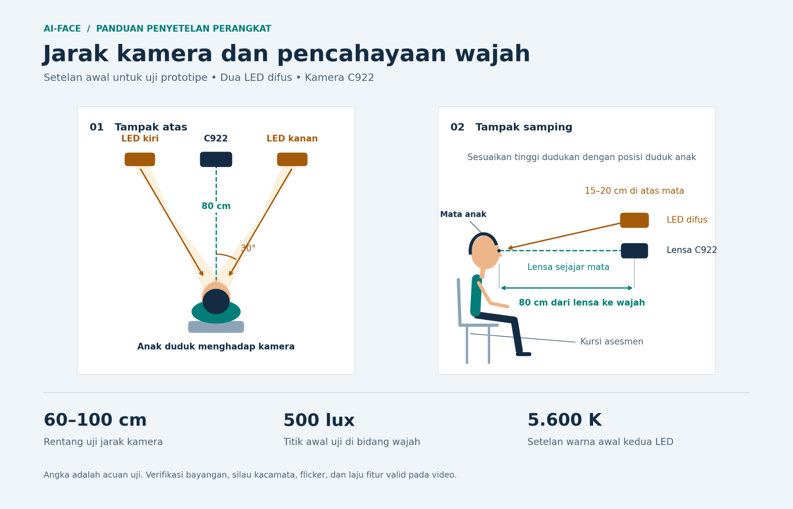

# Desain hardware dan penempatan anak

| Komponen | Rancangan awal |
|---|---|
| Kamera | Logitech C922 melalui USB, mikrofon dinonaktifkan |
| Pemrosesan | Mini PC Ryzen 5 5560U, RAM 16 GB, SSD 500 GB sebagai acuan rancangan |
| Lampu | Dua LED berdifuser dengan dudukan yang dapat diatur, kiri dan kanan |
| Alat bantu | Lux meter, meteran, kursi nyaman dan dudukan kamera yang dapat diatur |
| Mode uji | 1080p/30 fps terlebih dahulu, lalu bandingkan 720p/60 fps jika diperlukan |

## Geometri dan pencahayaan

1. Posisikan anak menghadap kamera. Ukur **80 cm dari lensa ke wajah** dengan lensa sejajar mata. Sesuaikan perangkat mengikuti tinggi duduk anak.
2. Tempatkan lampu pada sekitar **30° dari garis kamera–wajah** untuk tiap sisi. Selisih horizontal sekitar 45–46 cm per sisi pada jarak 80 cm jika lampu berada di bidang kamera. Pusat lampu **15–20 cm di atas mata**, diarahkan ke wajah. Tampak samping memperlihatkan elevasi salah satu lampu.
3. Gunakan **500 lux** pada bidang wajah sebagai awal. Letakkan lux meter pada posisi wajah dengan sensor menghadap kamera dan catat kondisi cahaya ruangan. Setel kedua lampu sekitar **5.600 K** jika perangkat mendukungnya.
4. Periksa kedua mata, alis dan mulut di pratinjau. Atur diffuser atau sudut jika kacamata berkilau. Atur letak anak atau cahaya ruangan jika muncul bayangan keras atau wajah terlalu terang.

## Uji konfigurasi

| Tahap | Variabel uji | Variabel yang dipertahankan |
|---|---|---|
| Jarak | 60, 80, 100 cm | Sekitar 500 lux pada posisi wajah dan mode kamera yang sama |
| Iluminansi | 300, 500, 700 lux | Jarak terpilih, mode kamera, posisi lampu, dan suhu warna yang sama |
| Mode kamera | 1080p/30 fps dan 720p/60 fps | Geometri dan iluminansi terpilih |

Rekam 30 detik per konfigurasi. Jika memungkinkan, ulangi dengan kondisi kacamata dan gerakan kepala yang relevan. Catat mode aktual, jarak, lux, validitas fitur, laju aktual, kedipan lampu, pantulan, dan kenyamanan. Uji teknis awal dapat menggunakan orang dewasa berizin. Angka pada diagram adalah parameter uji, bukan spesifikasi klinis yang sudah tervalidasi. Simpan konfigurasi terpilih sebagai versi protokol dan catat penyimpangan setiap sesi.
