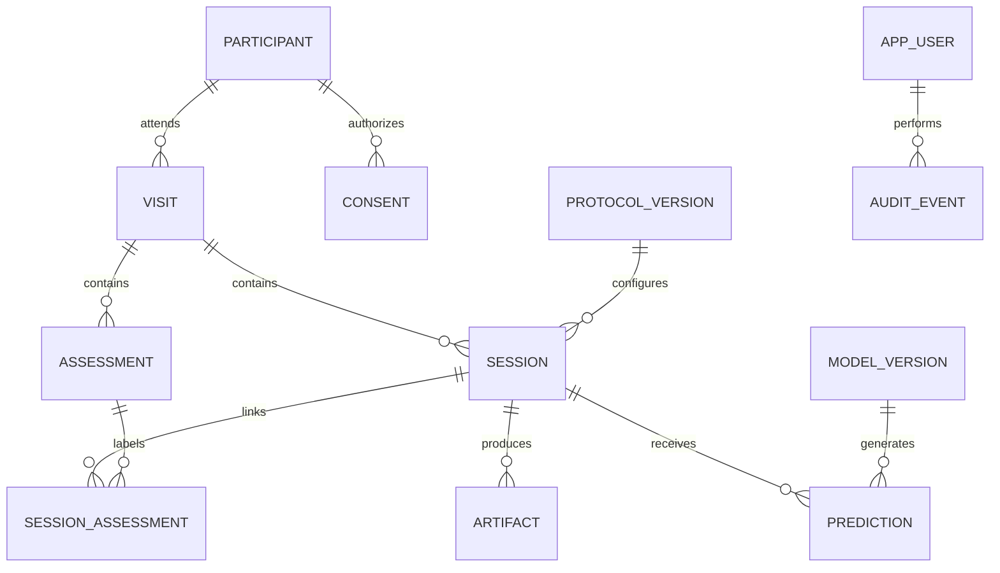

# ERD dan desain basis data

| Tabel | Kunci dan atribut penting |
|---|---|
| `participant` | UUID PK, `participant_code` unik, kelompok usia, status riset |
| `visit` | UUID PK, FK peserta, waktu kunjungan, konteks terapi terstruktur bila diizinkan |
| `consent` | UUID PK, FK peserta, versi protokol dan dokumen, cakupan, status, waktu mulai dan pencabutan, referensi berkas terbatas |
| `protocol_version` | UUID PK, kode versi unik, konfigurasi perangkat, akuisisi, kualitas, instrumen, dan status |
| `session` | UUID PK, FK kunjungan, FK versi protokol dan persetujuan yang diverifikasi, FK operator, ID perangkat, keadaan sesi dan kualitas, waktu, jumlah slot, metadata setup dan aktivitas, FK sesi sebelumnya opsional |
| `assessment` | UUID PK, FK kunjungan, FK penilai, instrumen/versi, pihak pengisi, nilai, periode rujukan, waktu ukur |
| `session_assessment` | PK gabungan sesi–asesmen, FK ke keduanya, peran label dan waktu pengaitan |
| `artifact` | UUID PK, FK sesi, jenis, versi skema, path relatif internal, SHA-256, ukuran byte, status retensi |
| `model_version` | UUID PK, versi unik, hash artefak, versi skema fitur, versi dataset, target, ambang, status dan konteks penggunaan |
| `prediction` | UUID PK, FK sesi dan model, nilai numerik atau kelas sesuai target, waktu evaluasi, alasan penahanan bila relevan |
| `app_user`, `audit_event` | Pengguna dengan peran. Audit mencatat FK aktor bila tersedia, aksi, jenis dan ID objek, waktu, hasil serta ID permintaan. |
| `idempotency_request` | Kunci unik aktor, rute, dan idempotency key. Simpan hash payload dan referensi hasil atau respons terkontrol. |

## Integritas dan siklus simpan

- Terapkan FK, UUID, UTC, dan `unique(session_id, model_version_id)` pada prediksi. Terapkan indeks untuk sesi per kunjungan, asesmen per kunjungan, audit berdasarkan waktu, dan status perangkat.
- Asesmen yang dikaitkan dengan sesi harus dari kunjungan yang sama. Verifikasi persetujuan mencakup peserta dan aktivitas yang benar. Pastikan hanya satu label primer per sesi untuk satu target yang sudah ditentukan. Perubahan label dicatat dan dataset yang telah diekspor tetap berversi.
- Satu sesi `recording` atau `processing` per perangkat. Gunakan indeks unik parsial dan koordinasi akses kamera. Transisi status atomik untuk start, stop, dan finalisasi.
- Slot fitur disimpan sebagai satu file per sesi. Tulis ke file sementara pada volume yang sama, validasi jumlah baris dan checksum, lalu pindahkan secara atomik. Setelah file final tersedia, komit metadata dan status dalam transaksi. Rekonsiliasi file final tanpa metadata dan sesi aktif setelah restart. Kegagalan parsial tidak menjadi sesi lengkap.
- Video mentah memerlukan jenis artefak dan cakupan izin terpisah. Database menyimpan referensi terkontrol, bukan path yang diperlihatkan langsung kepada klien.
