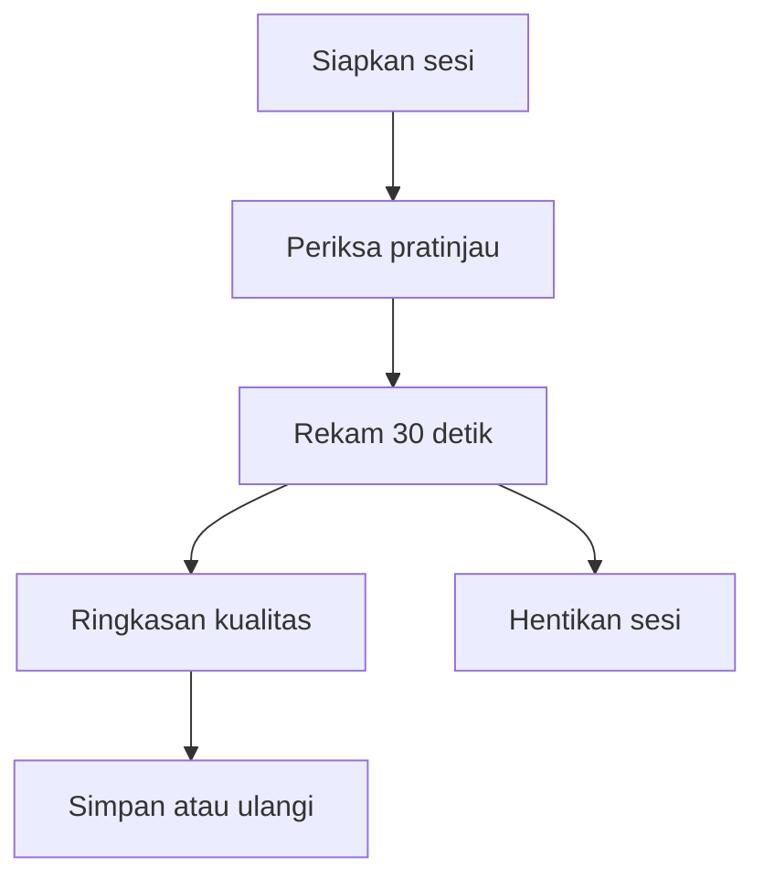

# Desain antarmuka AI-FACE

Antarmuka unit penelitian menggunakan bahasa Indonesia. Prioritaskan keterbacaan di ruangan pemeriksaan, tindakan yang jelas, dan umpan balik yang tetap dapat dipahami tanpa warna. Gunakan React + TypeScript pada tahap integrasi.

| Layar | Tata letak | Isi dan tindakan |
|---|---|---|
| Siapkan sesi | Form di kiri, pratinjau kamera di kanan | Pilih peserta berkode dan kunjungan. Verifikasi izin. Catat jarak, lux, mode, aktivitas dan pengulangan. Tampilkan panduan posisi. |
| Perekaman | Pratinjau dominan, panel kualitas di samping | Waktu berjalan, slot valid, petunjuk posisi, tombol Hentikan yang selalu mudah dijangkau. |
| Ringkasan sesi | Ringkasan di atas, rincian kualitas di bawah | Status sesi, 450 slot nominal, slot valid, alasan kegagalan utama, simpan/finalisasi sesuai alur, ulangi sebagai sesi baru. |
| Asesmen | Form terpisah dan akses penilai | Instrumen, versi, pihak pengisi, waktu ukur, periode rujukan, dan skor. Prediksi disembunyikan dari jalur asesmen independen. |
| Riwayat | Tabel berdasarkan kode sesi dan tanggal | Filter kualitas dan status, buka rincian terbatas, ekspor hanya untuk pengguna berwenang. |

## Perilaku layar

- Memulai sesi mensyaratkan kamera siap dan izin yang diperlukan. Saat perekaman aktif, kunci penggantian peserta dan cegah start ganda. Saat berhenti, konfirmasi bila diperlukan tanpa menghambat penghentian capture. Bila koneksi terputus, sambungkan kembali status berdasarkan ID sesi sebelum mengizinkan tindakan berikutnya.
- Tampilkan label teks untuk `Wajah terdeteksi`, `Posisikan wajah di tengah`, `Pencahayaan kurang`, `Data tidak memadai`, dan `Estimasi belum tersedia`. Hindari angka distress rekaan. Kemajuan waktu dan persentase kualitas tampil dengan label berbeda.
- Jika perlu mode tampilan untuk anak, sediakan instruksi sederhana tanpa catatan medis atau skor. Pastikan tombol dapat dioperasikan dengan keyboard, fokus terlihat, dan pratinjau bercermin diberi keterangan. Data analisis mempertahankan konvensi kamera konsisten.
- Pada pilot teknis, hasil utama adalah ringkasan sesi. Pada evaluasi model, keluaran penelitian hanya tampil bagi peran yang diotorisasi, bersama versi model dan konteks evaluasinya.
